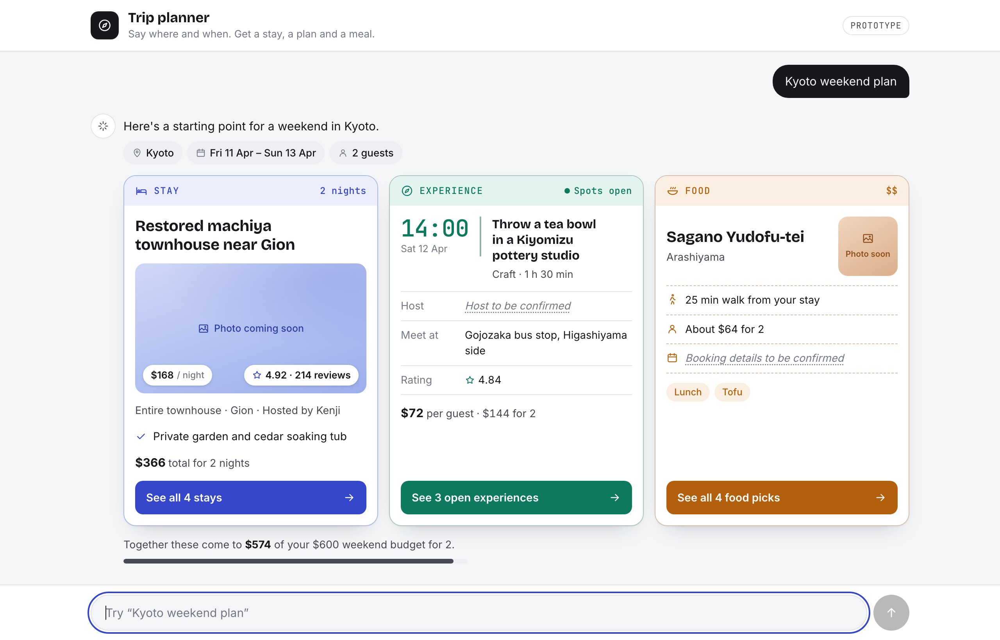

# Kyoto trip planner

A chat-style search prototype. A guest types a trip idea like "Kyoto weekend plan". Instead of an empty results page, they get three starting points: a place to stay, something to do and somewhere to eat. They don't have to set a single filter first.

This is the prototype for the spec sheet "Building Airbnb's Kyoto trip planner before Thursday's guest test". It's a concept prototype, not an official Airbnb product.



## Run it

```bash
npm install
npm run dev
```

Open <http://localhost:3000>. Then type a trip idea, or click **Try "Kyoto weekend plan"**.

To open straight to a reply, which is handy for testers, use <http://localhost:3000/?q=Kyoto%20weekend%20plan>.

## What happens when you send a message

1. Your message appears as a bubble on the right.
2. The message box and send button lock, and pulsing dots show in the reply bubble for 1.8 seconds.
3. The reply arrives. It shows what was understood (Kyoto, Fri 11 – Sun 13 Apr, 2 guests), then three cards, then how much of the $600 weekend budget the three picks use.
4. The message box unlocks and gets focus back, ready for the next message.

Every message gets the same Kyoto reply, because this stage uses a fixed mock response.

## The three cards

Each card has its own color, its own image box position and its own largest text, so they look different even with the words covered.

| Card | Color | Image box | Largest text |
| --- | --- | --- | --- |
| Stay | Indigo | Wide, under the headline. Price and rating sit on the photo. | Listing title |
| Experience | Green | None | Start time (14:00) |
| Food | Saffron | Small square, right of the headline | Place name |

The content pack has no photo URLs because image rights aren't cleared, so both image boxes show a "Photo coming soon" placeholder.

## Where the content comes from

The mock reply uses one row from each sheet of **Kyoto Weekend Prototype Content Pack.xlsx**, copied into [`data/contentPack.ts`](data/contentPack.ts):

| Sheet | Row | Pick |
| --- | --- | --- |
| Stays | S1 | Restored machiya townhouse near Gion, $366 for 2 nights |
| Experiences | E4 | Throw a tea bowl in a Kiyomizu pottery studio, $144 for 2 |
| Food | F2 | Sagano Yudofu-tei, about $64 for 2 |

These three come to $574 of the $600 reference budget.

E4 has no host name and F2 has no booking note. Empty cells become filler text ("Host to be confirmed", "Booking details to be confirmed"), shown in muted italics with a dotted underline so testers can tell it isn't real content. To change the picks or the filler wording, edit `PICKED_ROWS` and `FILLER` in [`lib/mockReply.ts`](lib/mockReply.ts).

The reply follows the spec's response shape. `cards` is always ordered stay, experience, food, and every card has the same fields: `card_type`, `header_label`, `headline`, `items`, `tags` and `cta`. See [`lib/types.ts`](lib/types.ts).

## Project layout

```text
app/
  layout.tsx              Fonts and page metadata
  page.tsx                Renders the chat page
  globals.css             Color tokens (light and dark) and base styles
components/
  ChatPage.tsx            Header, scrolling thread, locking message box
  ThinkingDots.tsx        Pulsing dots shown while the reply loads
  TripReplyView.tsx       Understood-intent chips, the three cards, budget line
  cards/
    StayCard.tsx          Stay card and its layout
    ExperienceCard.tsx    Experience card and its layout
    FoodCard.tsx          Food card and its layout
    cardBase.module.css   Frame, header strip and button shared by all cards
    Filler.tsx            Styles filler text for empty content pack cells
data/contentPack.ts       Rows from the content pack workbook
lib/mockReply.ts          Builds the reply from the picked rows
lib/types.ts              Reply shape from the spec
```

Styling is plain CSS Modules, one file per component, with no UI library.

## Not in this stage

- Error bubbles and the `/fail` test switch from the spec
- Editing the understood-intent chips
- Card buttons opening results pages
- Follow-up messages that refine the cards
